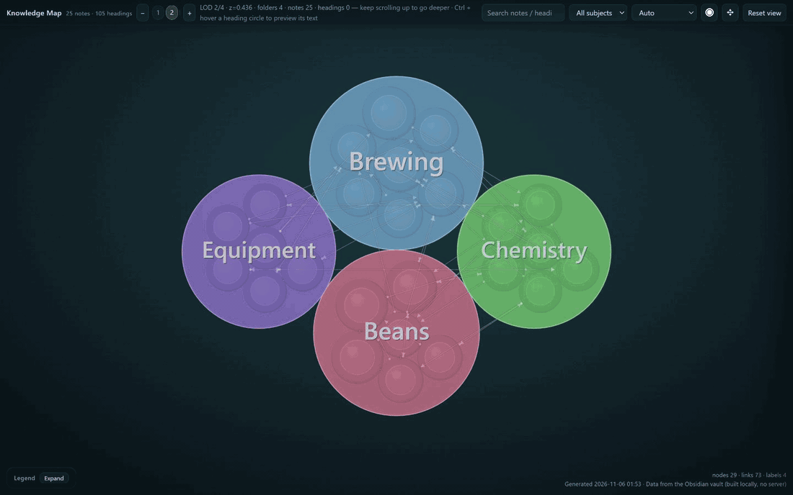
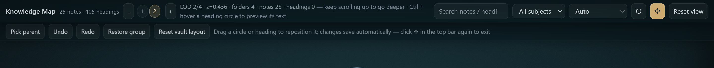
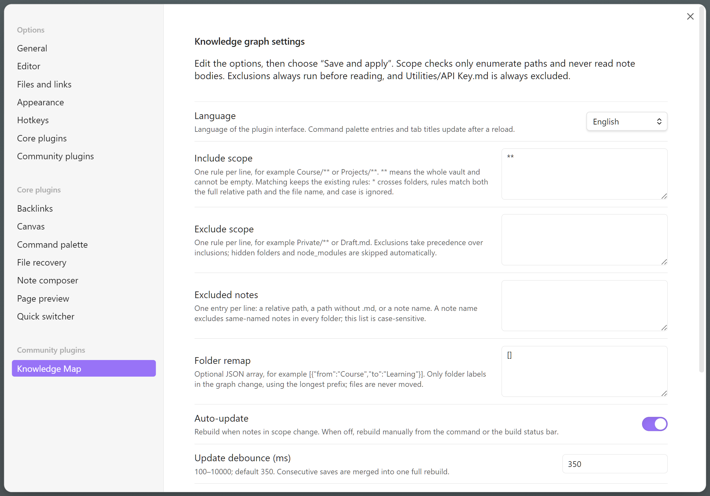
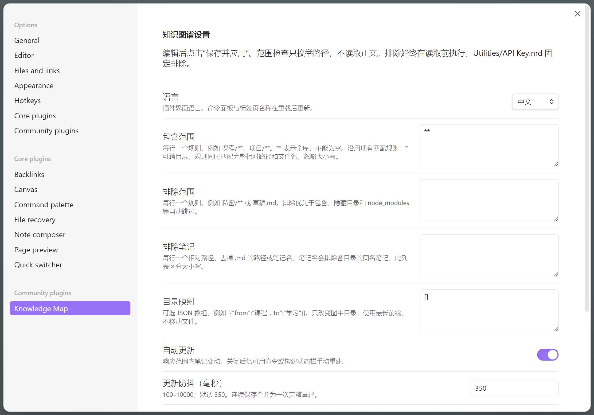

# Knowledge Map

**Knowledge Map turns your Obsidian vault into an interactive, zoomable map of what you know.** Notes, folders and headings become circles you can explore level by level; wiki-links become edges between them. You can drag circles to arrange the map, and the arrangement you make is kept when files are renamed, moved between folders, or when unrelated notes change.

Available in the Obsidian community directory: [community.obsidian.md/plugins/knowledge-graph-smoke](https://community.obsidian.md/plugins/knowledge-graph-smoke) · desktop only

## The idea

A vault is already a hierarchy. The top-level folders are your subjects, the notes inside them are topics, and the headings inside a note are the details. A file explorer shows that structure one folder at a time, so the shape of the whole vault never becomes visible.

Knowledge Map draws the whole hierarchy at once, as nested circles: a folder contains its notes, a note contains its headings, and every `[[link]]` between them is an edge. Nothing is invented or summarised — every circle is a real folder, note or heading, and the map is built locally from your Markdown files.

The map is meant to be *arranged*. Once a region reads well — the notes you use together, sitting together, the distracting branch pushed aside — drag it into that shape. The plugin stores the arrangement per group in its own `data.json` (never in your notes) and reconciles it after renames, folder moves and unrelated edits. If a structure changed too much to reconcile, only that group falls back to the automatic layout.

## Try it in a minute

1. **Install** (see [Install](#install)) and open the map from the ribbon icon or the command **Build knowledge map from current vault**.
2. **Move between levels.** Hover a circle and scroll up to drill in level by level; scroll down to go back out. The level pills at the top, `[` and `]`, and `Home` (back to the default view) do the same thing.
3. **Read a circle.** Click it: the side panel shows the note or heading, only its links stay lit, and directly connected circles get a blue ring. **Double-click** to focus on it, **Esc** to clear the selection.
4. **Hover for a preview.** Ctrl + hover a circle to preview the note in the panel (formulas, tables, images and embedded notes render natively); click to pin it.
5. **Arrange it.** Press ✥ **Adjust layout** in the top bar. Drag a circle (or a whole group) where you want it, then leave the mode. The toolbar under the top bar gives you **pick a parent**, **undo**, **redo**, **restore this group**, and **restore the whole library to automatic layout**; Esc cancels the current drag.

6. **Choose the language.** Settings → Community plugins → Knowledge Map → Language: *Follow the app* (default), *中文* or *English*. The map and the settings tab re-render immediately.

| English settings | 中文设置 |
| --- | --- |
|  |  |

## Reading the map

- **Colour = subject.** Circles take the colour of their top-level folder.
- **Size = scale.** The more elements sit underneath a circle, the larger it is.
- **Shape = kind.** Folders, notes and headings are all solid circles; the map tells them apart by level, label and size, and the legend lists the exact rules (press `L` to collapse or expand it).
- **Edges = `[[links]]`.** One thin line per link, at every scale. A dot marks the source end and an arrow the target end; direction-less parallel links are dashed; headings are connected to their note by a faint dotted "contains" chain.
- **Highlighting.** A yellow halo marks search hits; a blue ring marks what is directly connected to the current selection.

## Features

- **Hierarchical map** — folders, notes and headings drawn as one nested structure; explore it level by level with the scroll wheel, level pills, `[` `]` or `Home`.
- **Colour and size carry meaning** — colour follows the top-level folder, size follows the size of the subtree. Wiki-link edges connect headings; selecting a circle highlights everything connected to it.
- **Saved drag-and-drop layout** — drag a circle or a group into place. Positions are stored per group in the plugin's `data.json`, never in your notes. Layouts survive file and heading renames, folder moves and unrelated edits; when a structure changes too much to reconcile, only that group falls back to the automatic layout.
- **Search, levels and labels** — search notes and headings, jump between levels, filter by top-level folder, toggle labels, and zoom precisely.
- **Preview without leaving the map** — Ctrl + hover a circle to preview the note or heading, click to pin it, Esc to close.
- **Bilingual interface** — English and 简体中文, following Obsidian's language by default and switchable in the settings.
- **Scope and performance controls** — include/exclude ranges, exclude specific notes, optionally remap folder names, configure auto-update debounce, and cap preview characters.
- **Layout adjustment mode** — a toolbar under the top bar to pick a parent, undo/redo, restore this group, or restore the whole library to automatic layout.

## Install

1. Open **Settings → Community plugins → Browse** in Obsidian and search for **Knowledge Map** (desktop only), or open the [directory page](https://community.obsidian.md/plugins/knowledge-graph-smoke) and choose *Add to Obsidian*.
2. Enable the plugin, then open the map from the ribbon icon on the left sidebar or the command **Build knowledge map from current vault**.
3. Open the plugin settings to choose which folders take part in the map.

Manual install: copy `main.js`, `manifest.json` and `styles.css` into `.obsidian/plugins/knowledge-graph-smoke/` and enable the plugin. Release files are published on the [releases page](https://github.com/xidianhush/knowledge-graph-obsidian-plugin/releases); since 0.0.14 a release contains exactly those three files, with checksums in the release body. See [INSTALL.md](docs/INSTALL.md) for upgrade, rollback and data details.

## Compatibility and current limits

- Desktop Obsidian **1.6.7 or newer** (`isDesktopOnly: true`). Mobile is not supported.
- Layout adjustment is supported for up to **128 siblings per group** and **5000 affected nodes**; larger groups stay on the automatic layout.
- Undo history keeps the **last 50 steps** and is cleared when the plugin reloads or the structure changes.
- Data written by 0.0.10 and older cannot be adjusted by schema-3 builds; the original data is preserved.
- The canvas is deliberately dark and does not follow a light Obsidian theme.

## 中文简介

**Knowledge Map（知识地图）** 把整个 Obsidian 库渲染成一张可缩放的知识地图：目录、笔记、标题逐层展开成圆，圆的大小代表子结构规模、颜色对应顶层目录，`[[链接]]` 变成连线。可以把圆拖到更合适的位置，布局按组保存在插件数据里，**不写笔记**；文件改名、目录移动、无关内容增删后，已保存的布局仍会保留（结构差异过大时，仅该组回退为自动布局）。

**上手一分钟**：装好后用 ribbon 图标或命令「从当前库构建知识图谱」打开；光标放在圆上向上滚逐层深入、向下滚回粗层（层级胶囊、`[` `]`、`Home` 也可以）；单击看详情、双击聚焦、Esc 收起；Ctrl + 悬停预览笔记；点顶栏 ✥「调整布局」后可拖动圆或整组，横带里可撤销/重做/恢复此组/全库恢复，Esc 取消当前拖动。

界面支持**英文 / 简体中文**：默认跟随 Obsidian 语言（非中文环境为英文），可在「设置 → 第三方插件 → Knowledge Map → 语言」固定为「跟随应用 / 中文 / English」，切换后地图与设置页立即刷新。

- **安装**：社区插件市场搜索 **Knowledge Map**（桌面版），或把 `main.js`、`manifest.json`、`styles.css` 复制到 `.obsidian/plugins/knowledge-graph-smoke/`。
- **要求**：Obsidian 1.6.7+ 桌面版；移动端不支持。
- **限制**：布局调整支持单组 128 个同级节点、5000 个受影响节点以内；撤销保留最近 50 步。

## Data and privacy

The plugin only reads the Markdown files in the ranges you configure and writes its own settings, layout data and one piece of UI state (whether the legend is collapsed) to `.obsidian/plugins/knowledge-graph-smoke/data.json`. It does not modify notes, does not send your notes anywhere, and makes no network requests at runtime. The preview panel renders note excerpts in memory only.

## Development

The release bundle is built with the Node.js standard library only (no npm runtime dependencies, no lockfile); `node scripts/build.mjs` produces `dist/main.js`, and `node scripts/test.mjs` runs the eleven synthetic checks (`11` scripts, all passing on 0.0.14), including `scripts/i18n_check.mjs`, which keeps the English and Chinese dictionaries in sync and rejects untranslated UI strings.

- [docs/DEV_LOG.md](docs/DEV_LOG.md) — development and acceptance log for 0.0.1–0.0.13 and the 0.0.14 candidate (Chinese)
- [TODO.md](TODO.md) — current tasks, acceptance status and evidence
- [DEVELOPMENT.md](DEVELOPMENT.md) — build/test workflow and delivery boundaries
- [docs/INSTALL.md](docs/INSTALL.md) — install, upgrade, rollback, known limits
- [docs/RELEASE_NOTES_0.0.14.md](docs/RELEASE_NOTES_0.0.14.md) — 0.0.14 release notes
- [docs/RELEASE_CI.md](docs/RELEASE_CI.md) — tagged-release workflow and attestation verification
- [AGENTS.md](AGENTS.md) — collaboration conventions

## License

[MIT](LICENSE)
