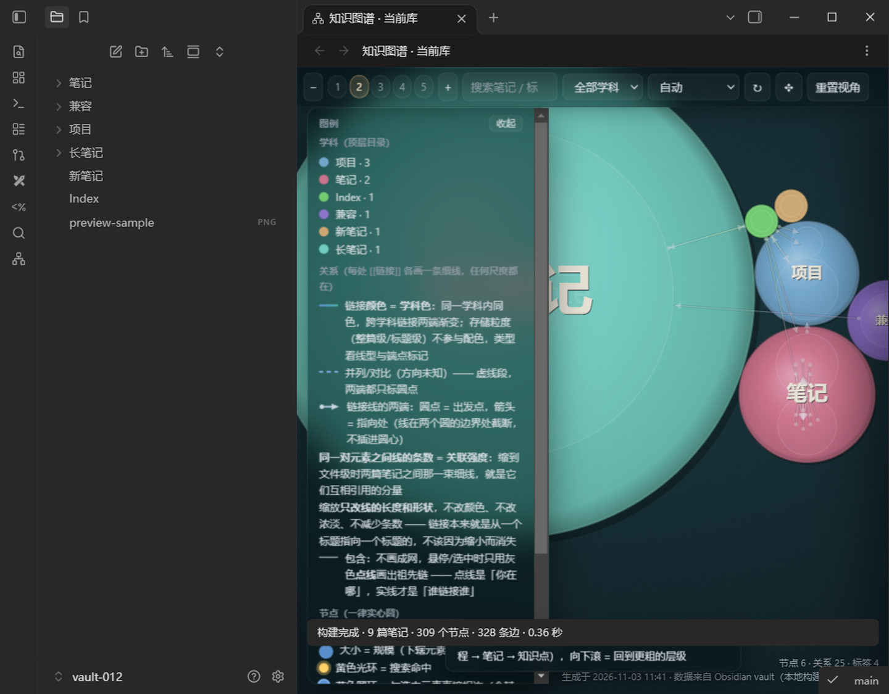

# Knowledge Map

**Knowledge Map turns your Obsidian vault into an interactive, zoomable map of what you know.** Notes, folders and headings become circles you can explore level by level; wiki-links become edges between them. You can drag circles to arrange the map, and the layout you arrange is kept when files are renamed, moved between folders, or when unrelated notes change.

Available in the Obsidian community directory: [community.obsidian.md/plugins/knowledge-graph-smoke](https://community.obsidian.md/plugins/knowledge-graph-smoke)

## Features

- **Hierarchical map** — folders, notes and headings are drawn as a single nested structure. Click a circle to zoom in one level; hold Ctrl (or middle-click) to go back out.
- **Colour and size carry meaning** — colour follows the top-level folder, size follows the size of the subtree. Wiki-link edges connect headings; selecting a circle highlights everything connected to it.
- **Saved drag-and-drop layout** — drag a circle (or a group) to a better position. Positions are stored per group in the plugin's `data.json`, never in your notes. Layouts survive file and heading renames, folder moves, and unrelated edits; when a structure changes too much to reconcile, only that group falls back to the automatic layout.
- **Search, levels and labels** — search notes and headings, jump between levels, filter by top-level folder, toggle labels, and zoom precisely.
- **Preview without leaving the map** — Ctrl + hover a circle to preview the note or heading in the panel (waiting for the hover preview), click to pin it, Esc to close. Formulas, tables, images and embedded notes render natively.
- **Scope and performance controls** — include/exclude ranges, exclude specific notes, optionally remap folder names in the map, configure auto-update debounce, and cap preview characters.
- **Layout adjustment mode** — a toolbar under the top bar lets you pick a parent, undo/redo, restore this group, or restore the whole library to automatic layout.

## Install

1. Open **Settings → Community plugins → Browse** in Obsidian and search for **Knowledge Map** (desktop only), or open the [directory page](https://community.obsidian.md/plugins/knowledge-graph-smoke) and choose *Add to Obsidian*.
2. Enable the plugin, then open the map from the ribbon icon on the left sidebar or the command **Build knowledge map from current vault**.
3. Open the plugin settings to choose which folders take part in the map.

Manual install: copy `main.js`, `manifest.json` and `styles.css` into `.obsidian/plugins/knowledge-graph-smoke/` and enable the plugin. Release files are published on the [releases page](https://github.com/xidianhush/knowledge-graph-obsidian-plugin/releases).

## Compatibility and current limits

- Desktop Obsidian **1.6.7 or newer** (`isDesktopOnly: true`). Mobile is not supported.
- Layout adjustment is supported for up to **128 siblings per group** and **5000 affected nodes**; larger groups stay on the automatic layout.
- Undo history keeps the **last 50 steps** and is cleared when the plugin reloads or the structure changes.
- Data written by 0.0.10 and older cannot be adjusted by schema-3 builds; the original data is preserved.

## 中文简介

**Knowledge Map（知识地图）** 把整个 Obsidian 库渲染成一张可缩放的知识地图：目录、笔记、标题逐层展开成圆，圆的大小代表子结构规模、颜色对应顶层目录，`[[链接]]` 变成连线。可以把圆拖到更合适的位置，布局按组保存在插件数据里，**不写笔记**；文件改名、目录移动、无关内容增删后，已保存的布局仍会保留（结构差异过大时，仅该组回退为自动布局）。

支持全文/标题搜索、层级跳转、学科过滤、标签开关、Ctrl 悬停预览（公式、表格、图片、嵌入笔记原生渲染）、包含/排除范围、笔记排除、目录映射、自动更新防抖与预览字符预算，以及顶栏下的「调整布局」工具条（选父级、撤销/重做、恢复此组、全库恢复自动布局）。

- **安装**：社区插件市场搜索 **Knowledge Map**（桌面版），或把 `main.js`、`manifest.json`、`styles.css` 复制到 `.obsidian/plugins/knowledge-graph-smoke/`。
- **要求**：Obsidian 1.6.7+ 桌面版；移动端不支持。
- **限制**：布局调整支持单组 128 个同级节点、5000 个受影响节点以内；撤销保留最近 50 步。

## Data and privacy

The plugin only reads the Markdown files in the ranges you configure and writes its own settings and layout data to `.obsidian/plugins/knowledge-graph-smoke/data.json`. It does not modify notes, does not send your notes anywhere, and makes no network requests at runtime.

## Development

The release bundle is built with the Node.js standard library only (no npm runtime dependencies, no lockfile); `node scripts/build.mjs` produces `dist/main.js`, and `node scripts/test.mjs` runs the ten synthetic checks (`10` scripts, all passing on 0.0.13).

- [docs/DEV_LOG.md](docs/DEV_LOG.md) — development and acceptance log for 0.0.1–0.0.13 (historical, Chinese)
- [TODO.md](TODO.md) — current tasks, acceptance status and evidence
- [DEVELOPMENT.md](DEVELOPMENT.md) — build/test workflow and delivery boundaries
- [docs/INSTALL.md](docs/INSTALL.md) — install, upgrade, rollback, known limits
- [docs/RELEASE_NOTES_0.0.13.md](docs/RELEASE_NOTES_0.0.13.md) — 0.0.13 release notes
- [AGENTS.md](AGENTS.md) — collaboration conventions

## License

[MIT](LICENSE)
