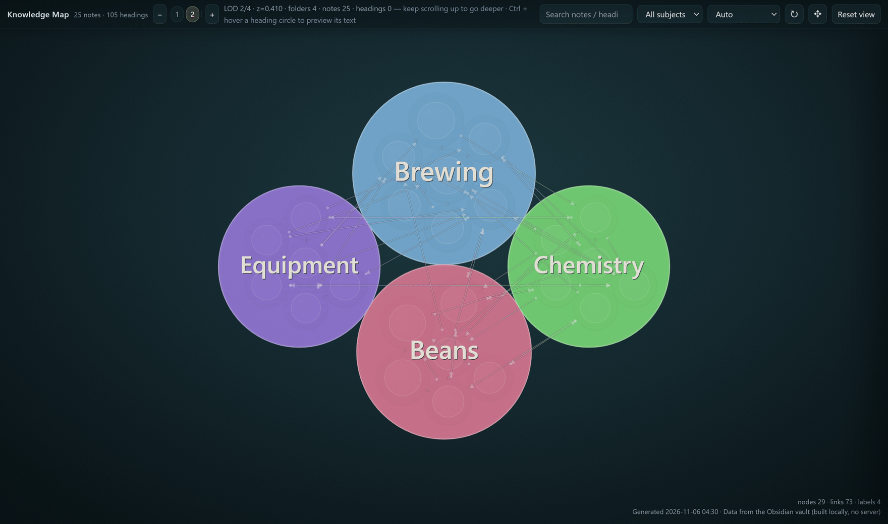
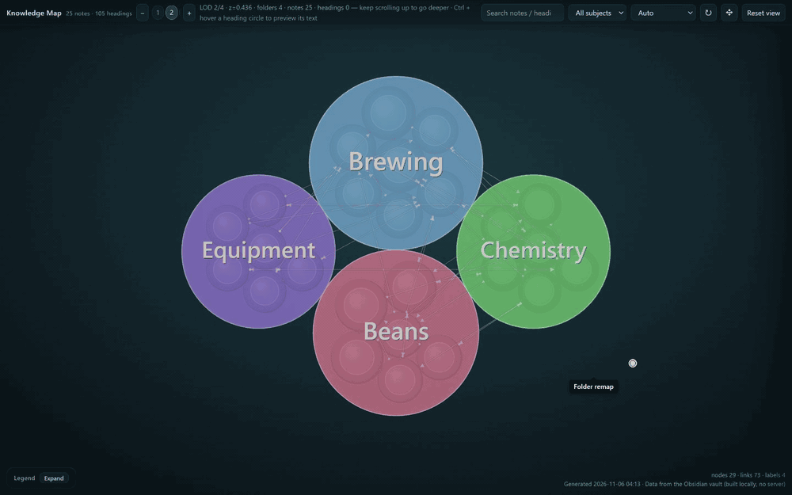
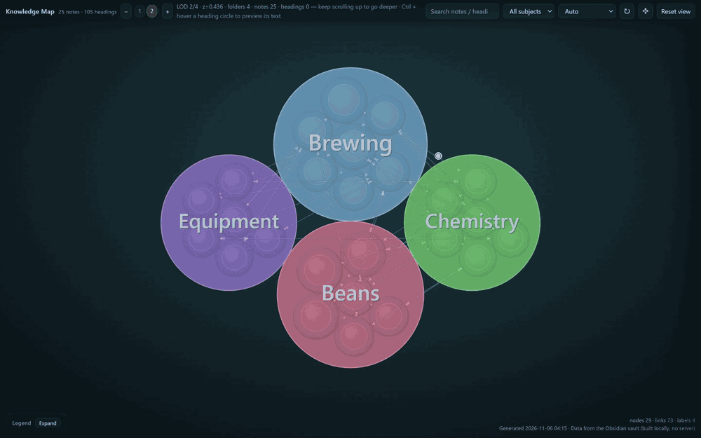
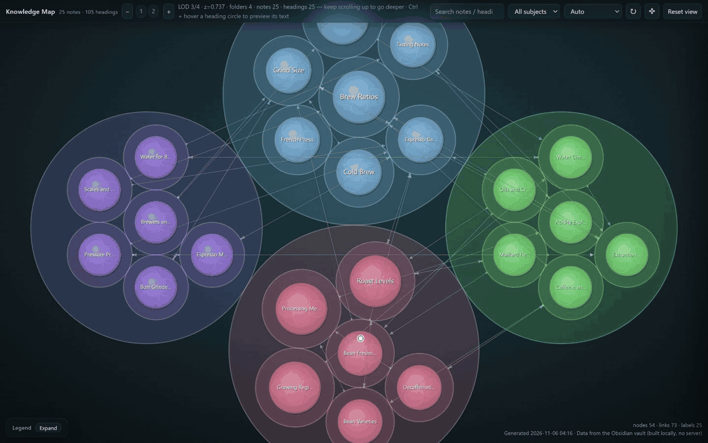
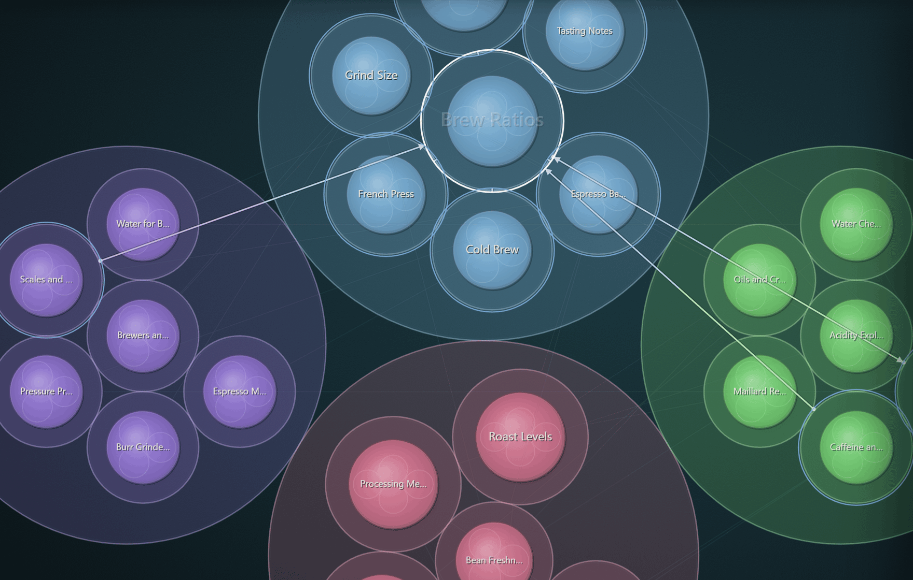
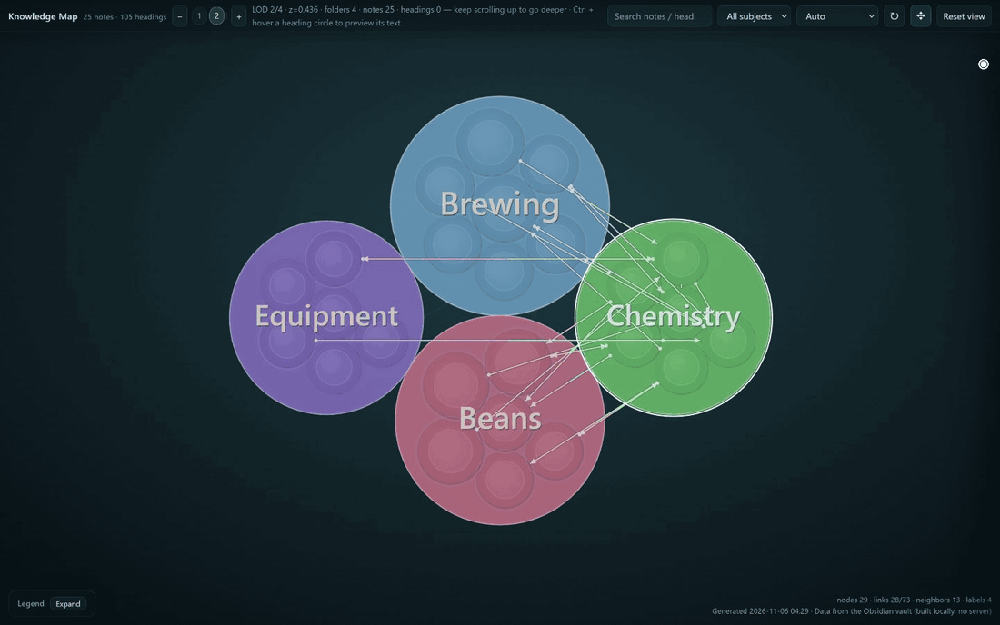

# Knowledge Map

**Explore the hierarchy and connections in your Obsidian knowledge as a map you can arrange.** Folders, notes and headings form nested circles; wiki-links connect them.

## Explore the hierarchy

See where knowledge belongs, from a subject down to a heading. Colour follows the top-level folder; circle size reflects the structure beneath it.

**Pan** — drag the canvas to explore another region; on iPad, use one finger.

**Zoom** — on desktop, scroll over a circle to explore deeper levels or come back out. On iPad, pinch to zoom or tap − / + to change levels. Use **Reset view** to return to the current level's default view.

**Preview** — on desktop, hold Ctrl and hover over a note or heading; click the circle to pin its preview. On iPad, hold a note or heading, or select it and tap **Preview**. Close the preview with its close button (or Esc on desktop).

## Follow the connections

See the chain between related ideas and follow it when investigating a question or tracing a problem.

A dot marks a link's source and an arrow its target. Dashed lines mark parallel / contrast relations. Select a circle to highlight its links and connected elements; a grey dotted line traces its ancestors. Visible links depend on zoom, filters and drawing limits.

## Arrange what matters

Put core ideas in the centre and supporting details around them.

Press ✥ **Adjust layout**, drag a circle, then press ✥ again to finish. The layout toolbar provides undo, redo and reset controls. Desktop also supports group dragging; touch layout editing moves one element at a time.

Layouts are saved separately from your notes and reused after edits where they can be reconciled. Incompatible groups fall back to automatic layout.

## Install and start

1. In **Settings → Community plugins → Browse**, search for **Knowledge Map**, install and enable it. You can also use the [directory page](https://community.obsidian.md/plugins/knowledge-graph-smoke).
2. Click the ribbon icon or run **Build knowledge graph from current vault** from the command palette.
3. Choose the folders to include in the plugin settings. The interface supports **English and 简体中文**, following the app language by default.

For manual installation, copy `main.js`, `manifest.json` and `styles.css` from a [release](https://github.com/xidianhush/knowledge-graph-obsidian-plugin/releases) into `.obsidian/plugins/knowledge-graph-smoke/`. See the [installation guide](docs/INSTALL.md) for upgrades, backups and rollback.

## Platforms and limits

- **Desktop:** Obsidian 1.6.7+.
- **iPadOS (0.0.15):** user testing covered iPad Pro 2022 / iPadOS 26.5.2 / Obsidian 1.15.0. The demos show desktop controls. iPhone is unverified; Android adaptation is planned for the next version. Minimum iPadOS and objective iPad frame-rate / memory limits have not been established.
- Layout editing supports up to **128 siblings per group** and **5000 affected nodes**. Undo keeps **50 steps** within the session and clears on structural changes or plugin reload.
- The map canvas stays dark, including with a light Obsidian theme.

## 中文简介

**Knowledge Map（知识地图）** 用嵌套圆展示知识的包含层级，用连线展示知识之间的联系。拖动画布探索，缩放查看层级，预览笔记内容；点 ✥「调整布局」，把核心知识放在中间、细节放在周围，再点一次结束。

桌面用 Ctrl + 悬停预览；iPad 用长按或选中后的「预览」按钮，触屏支持单元素拖动。0.0.15 加入 iPadOS 支持并保留桌面；iPhone 未验证，Android 适配留到下一版。

## Data and development

Map building happens locally within your configured scope. The plugin does not modify or upload your notes; settings and layouts are stored in the plugin's own `data.json`. Back up that file before upgrading or uninstalling.

[Data, upgrades and limits](docs/INSTALL.md) · [Build and test](DEVELOPMENT.md) · [Current tasks](TODO.md) · [0.0.15 release notes](docs/RELEASE_NOTES_0.0.15.md) · [MIT license](LICENSE)
